<a href="https://kasif-portfolio.netlify.app">
  <picture>
    <source media="(prefers-color-scheme: light)" srcset="docs/readme/banner-light.jpg" />
    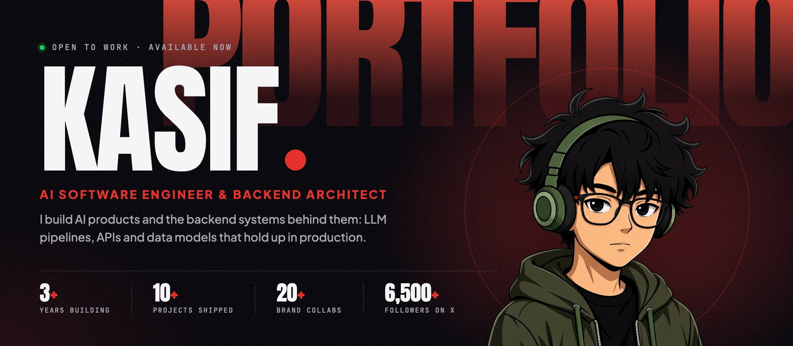
  </picture>
</a>

<p align="center">
  <a href="https://kasif-portfolio.netlify.app"></a>
  <a href="https://kasif-portfolio.netlify.app/cv.pdf"></a>
  <a href="https://x.com/md_kasif_uddin"></a>
</p>

<p align="center">
  
  
  
  
  
  
  
</p>

<p align="center">
  <b>A portfolio that builds itself in front of you.</b><br />
  Thirty AI agent cursors assemble the page from a blank canvas, every system is drawn as a working machine,<br />
  and the theme spreads across the screen like ink dropped in water.
</p>

<p align="center">
  <a href="#-the-site-in-motion">Motion</a> ·
  <a href="#-whats-inside">Features</a> ·
  <a href="#-a-look-around">Gallery</a> ·
  <a href="#-architecture">Architecture</a> ·
  <a href="#-by-the-numbers">Numbers</a> ·
  <a href="#-run-it">Run it</a>
</p>

<br />

## ◆ The site in motion

<table>
  <tr>
    <td width="50%" valign="top">
      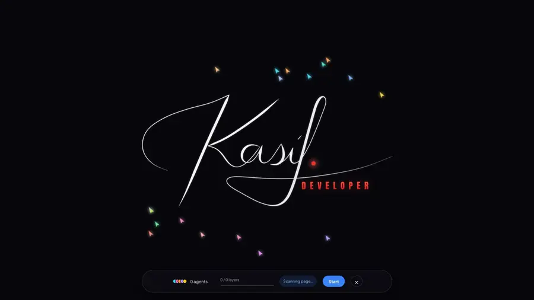
      <p><b>Build Mode.</b> On first visit, a crew of named agent cursors compiles the real page into jobs and builds it live: typing headings, pasting images, drawing gradients, retyping stats. The hero and footer play at full ceremony; everything between runs at 2×.</p>
    </td>
    <td width="50%" valign="top">
      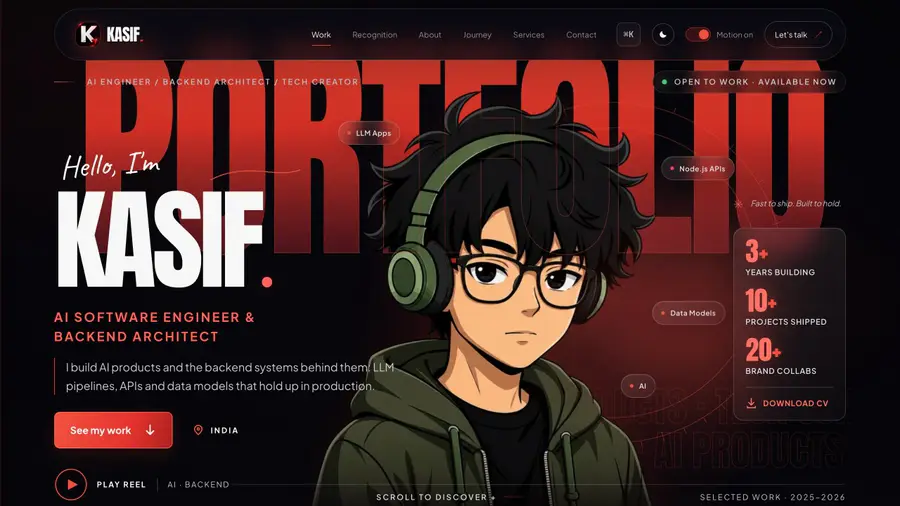
      <p><b>The ink switch.</b> The new theme bleeds out from the toggle with a torn, fibrous edge, streaks of the old theme left behind. Each switch is a fresh noise field, traced with marching squares every frame.</p>
    </td>
  </tr>
</table>

<br />

## ◆ What's inside

<table>
  <tr>
    <td width="33%" valign="top"><h3>🤖 Agent Build Mode</h3>A seeded, deterministic six-act film (scan, blueprint, build, polish, finale, handoff) driven by one shared clock. It hands the live page back untouched, then shows off the theme switch.</td>
    <td width="33%" valign="top"><h3>🖋️ Ink theme switch</h3>A view transition whose new page is clipped to a noise-shaped region. A warm paper light theme is <i>generated at build time</i> from the dark one by a custom PostCSS plugin.</td>
    <td width="33%" valign="top"><h3>⚙️ Systems as machines</h3>GitRoasted, Cookie and Crimson Gate drawn as interactive isometric machines. Click a part, see the code it stands for.</td>
  </tr>
  <tr>
    <td valign="top"><h3>🎬 Showreel player</h3>Five launch films in a custom player: chapters, scrub previews, 4K/1080p/720p sources, picture-in-picture and autoplay queue.</td>
    <td valign="top"><h3>📚 Case studies &amp; notes</h3>Three long-form case studies and four engineering notes, morphing in from the Work cards with the View Transitions API.</td>
    <td valign="top"><h3>📈 Built in the open</h3>A GitHub contribution graph snapshotted at build time and refreshed live, plus real X posts with their view counts.</td>
  </tr>
  <tr>
    <td valign="top"><h3>⌘K Command palette</h3>Search every project, note, section and action. Jump to a live demo, play the reel, switch the theme.</td>
    <td valign="top"><h3>🧲 Magnetic cursor</h3>A cursor that snaps to targets, inverts over type and ripples on click, kept live above page transitions.</td>
    <td valign="top"><h3>♿ Motion with manners</h3>One switch turns every animation off. <code>prefers-reduced-motion</code> is honoured everywhere, and every effect has a static fallback.</td>
  </tr>
</table>

<br />

## ◆ A look around

<table>
  <tr>
    <td>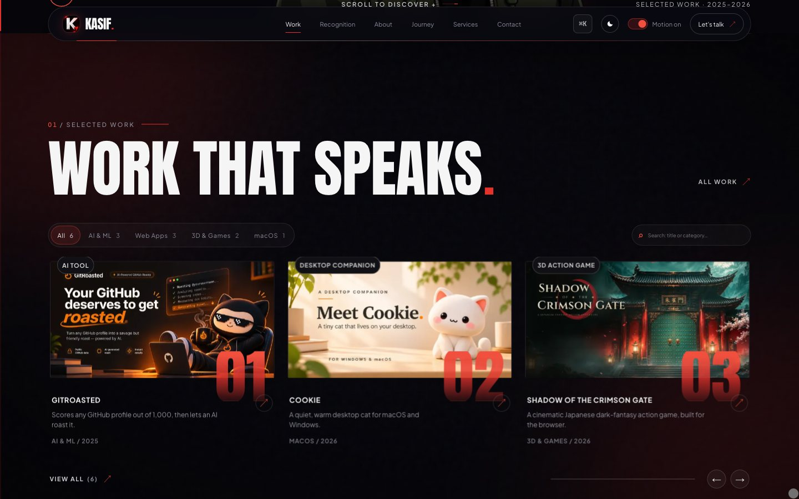</td>
    <td>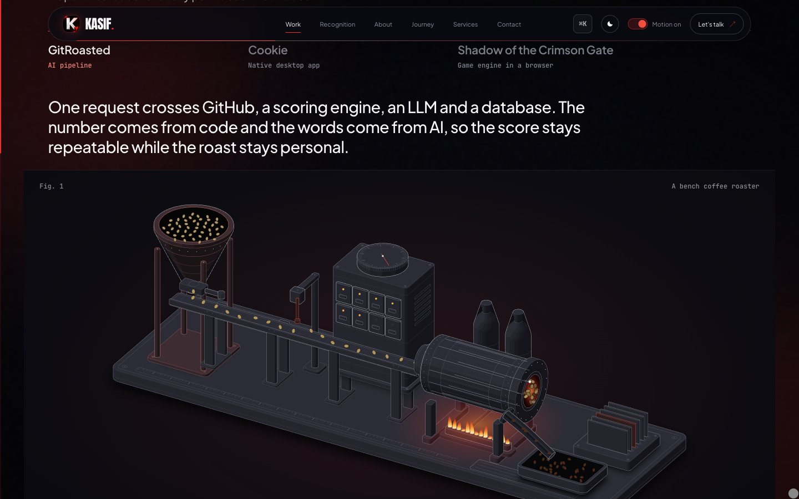</td>
  </tr>
  <tr>
    <td align="center"><sub><b>Work that speaks.</b> Filterable, searchable project cards with live clips.</sub></td>
    <td align="center"><sub><b>Every system is a machine.</b> GitRoasted as a bench coffee roaster.</sub></td>
  </tr>
  <tr>
    <td>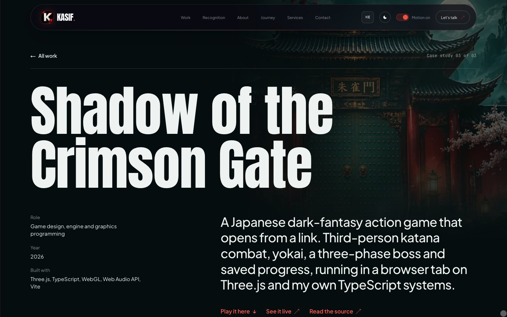</td>
    <td>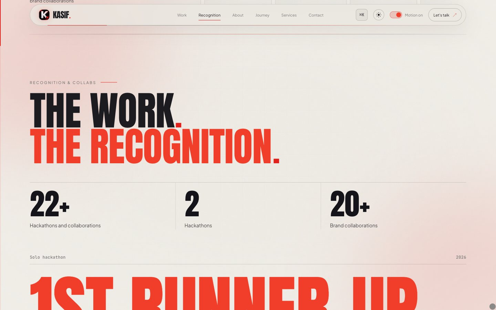</td>
  </tr>
  <tr>
    <td align="center"><sub><b>Case studies.</b> Decisions, trade-offs and what broke.</sub></td>
    <td align="center"><sub><b>Paper light theme.</b> Generated from the dark theme at build time.</sub></td>
  </tr>
  <tr>
    <td>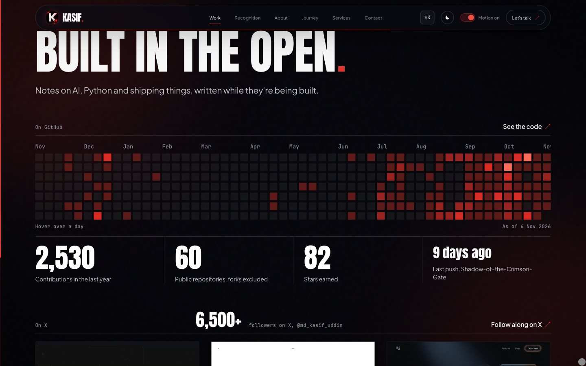</td>
    <td>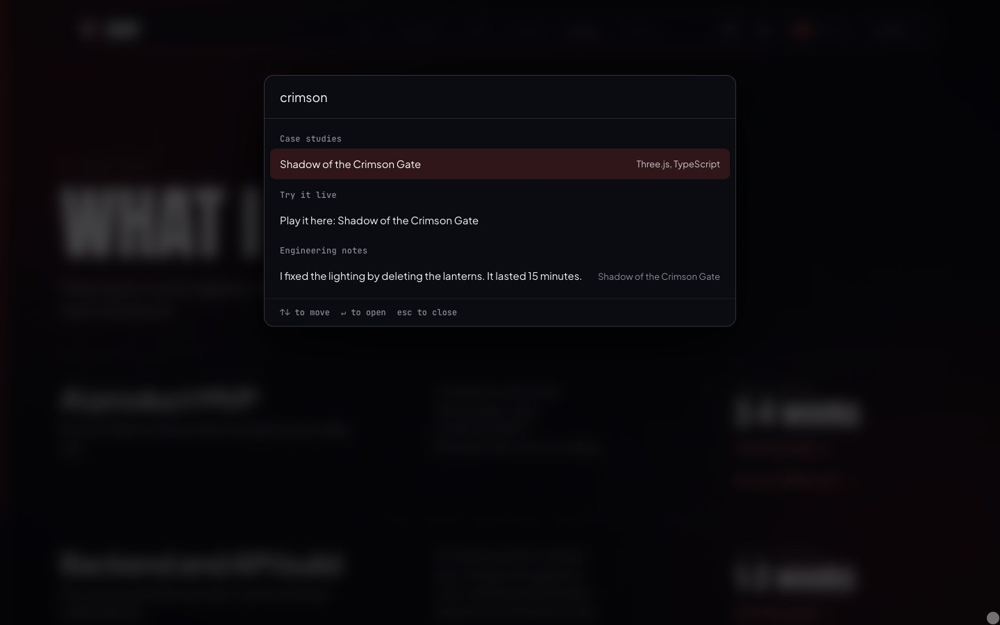</td>
  </tr>
  <tr>
    <td align="center"><sub><b>Built in the open.</b> A year of commits, live from GitHub.</sub></td>
    <td align="center"><sub><b>⌘K palette.</b> Everything on the site, one keystroke away.</sub></td>
  </tr>
</table>

<br />

## ◆ Architecture

The whole site is a **static export**. Everything that can be decided ahead of time is decided at build time: images are pre-sized, the light theme is generated, the GitHub graph is snapshotted, share cards and the CV are rendered. The browser only does what has to be live.

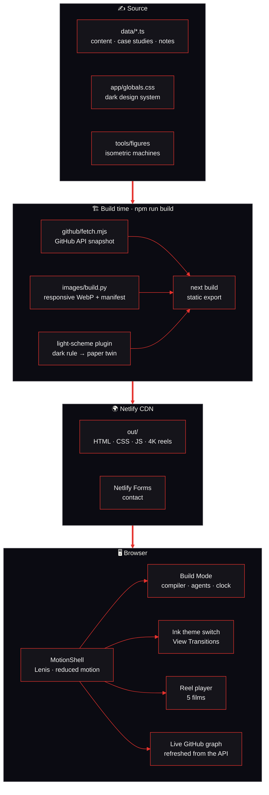

### Build Mode, from page to film

The engine never fakes the page. It reads the real DOM, hides it, and rebuilds it in front of you.

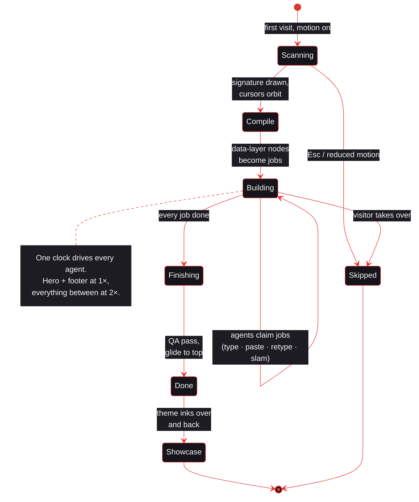

### The ink switch, frame by frame

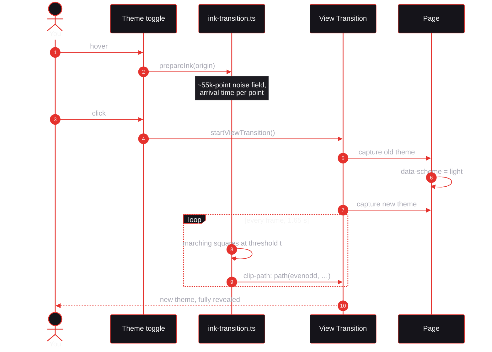

<br />

## ◆ By the numbers

**A year of commits.** Contributions per month across all of Kasif's GitHub, from the snapshot this site ships with.

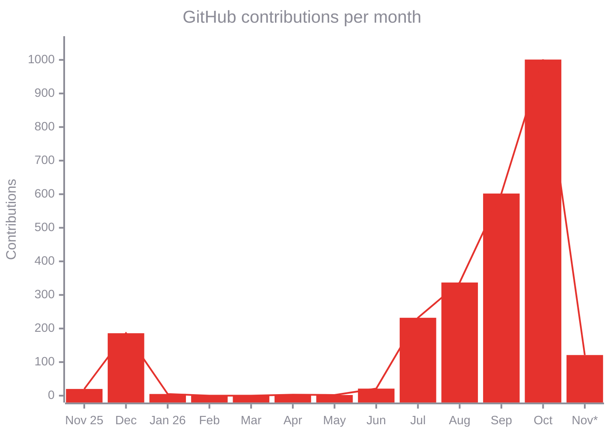

<sub>* November 2026 up to the 6th, when the snapshot was taken. 2,530 contributions in the year, 60 public repositories, 82 stars.</sub>

**Making the build film faster.** Seconds the camera spends on each section of Build Mode, measured before and after the hero/footer-at-1×, middle-at-2× change. The film went from 79 s to 53 s.

```mermaid
%%{init: {"theme": "base", "themeVariables": {"xyChart": {"titleColor": "#8b8b96", "xAxisLabelColor": "#8b8b96", "yAxisLabelColor": "#8b8b96", "xAxisTitleColor": "#8b8b96", "yAxisTitleColor": "#8b8b96", "xAxisLineColor": "#8b8b96", "yAxisLineColor": "#8b8b96", "xAxisTickColor": "#8b8b96", "yAxisTickColor": "#8b8b96", "plotColorPalette": "#5c5a60, #e5322d", "backgroundColor": "transparent"}}}}%%
xychart-beta
  title "Build Mode: seconds per section (grey before, red after)"
  x-axis ["Hero", "Work", "Recog.", "Systems", "About", "Journey", "Writing", "Services", "Contact", "Footer"]
  y-axis "Seconds" 0 --> 12
  bar [8.3, 5.8, 10.1, 11.4, 8.6, 5.8, 9.1, 7.6, 4.8, 7.1]
  bar [7.8, 3.3, 6.6, 7.8, 5.1, 3.8, 4.8, 4.6, 2.5, 6.8]
```

**What it's made of.** About 17,000 lines of hand-written code across `app/`, `components/`, `lib/`, `data/` and `tools/`.

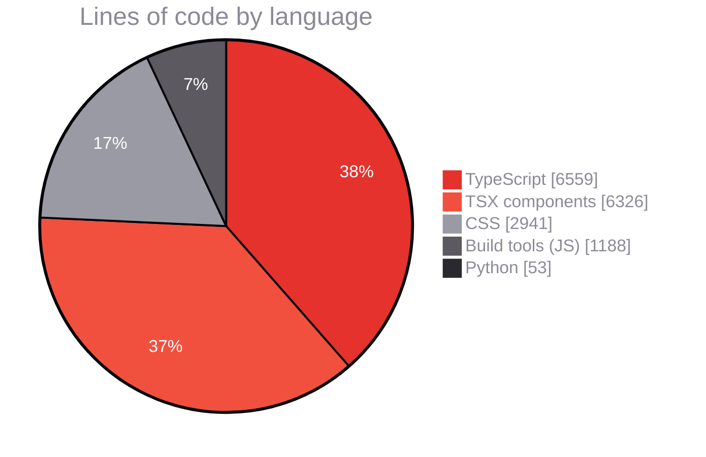

<br />

## ◆ Stack

| Layer | Tools |
| --- | --- |
| **Framework** | Next.js 14 App Router, static export · React 18 · TypeScript |
| **Motion** | GSAP · Framer Motion · Lenis smooth scroll · View Transitions API · a custom rAF clock for Build Mode |
| **Styling** | Hand-written CSS design system · Tailwind (base only) · a custom PostCSS plugin for the light theme |
| **Media** | Next Image with a custom loader and a pre-built WebP manifest · H.264 reels at 4K/1080p/720p |
| **Figures** | The MIT-licensed [Anatomy](https://github.com/wheresryan22/anatomy) isometric kit |
| **Build tools** | Node scripts for the GitHub snapshot, CV, share cards and figures · Python + Pillow for images |
| **Hosting** | Netlify CDN · Netlify Forms · Umami analytics (cookie-free, opt-in by env var) |

<br />

## ◆ Run it

```bash
npm install
npm run dev
```

Production export, served the way Netlify serves it:

```bash
npm run lint
npm run build
python3 -m http.server 8000 --directory out
```

`npm run build` first runs `tools/github/fetch.mjs` (the `prebuild` script) to refresh the GitHub snapshot, then exports the site to `out/`. Netlify runs the same command and publishes `out/` (see `netlify.toml`).

<details>
<summary><b>Environment variables</b></summary>

<br />

| Variable | What it does |
| --- | --- |
| `NEXT_PUBLIC_SITE_URL` | Production origin for metadata, `robots.txt` and the sitemap. Netlify's `URL` is the fallback. |
| `NEXT_PUBLIC_CAL_LINK` | Your Cal.com link. The booking buttons stay hidden until it is set. |
| `NEXT_PUBLIC_UMAMI_WEBSITE_ID` | Turns on cookie-free Umami analytics. Nothing loads without it. |

</details>

<details>
<summary><b>Project structure</b></summary>

<br />

```text
app/
  layout.tsx                Fonts, metadata, JSON-LD, the no-flash theme script
  page.tsx                  The home page, section by section
  work/[slug]/              Case studies (GitRoasted, Cookie, Crimson Gate)
  notes/                    Engineering notes
  globals.css               The dark design system (the light theme is generated from it)
components/
  agent-build/              Build Mode: provider, control bar, curtain swarm
    engine/                 compiler · agents · actions · clock · ghosts · overlay
  machines/                 Isometric machine figures and their motion
  ui/                       Magnetic cursor, halftone footer wordmark
  reel-player.tsx           The showreel player
  theme-toggle.tsx          The sun/moon switch
  …                         One file per section of the page
data/
  content.ts                Every word on the home page, typed
  case-studies.ts           Long-form case studies
  notes.ts · systems.ts     Engineering notes · machine steps
  github.json               The GitHub snapshot (regenerated on build)
lib/
  ink-transition.ts         Noise field + marching squares for the theme switch
  theme.ts · theme-showcase.ts
  view-transition.ts        Work card → case study morph
  image-loader.ts           Static-export image loader
tools/
  postcss/light-scheme.cjs  Generates the light theme
  github/ · images/ · figures/ · cv/ · share-cards/
public/
  reel/                     The five films, posters and scrub previews
  img/                      Pre-sized WebP variants
  projects/ · case-studies/ · brands/ · og/ · figures/
docs/readme/                The images in this README
```

</details>

<details>
<summary><b>Generated files</b></summary>

<br />

These outputs are checked in. Run a tool again after changing its source. Set `CHROME_PATH` if Chrome isn't in its usual place.

| Output | Command | Needs |
| --- | --- | --- |
| `public/img/*`, `lib/image-manifest.json` | `python3 tools/images/build.py` | Pillow |
| `public/cv.pdf`, from `tools/cv/cv.html` | `node tools/cv/build.mjs` | Chrome |
| `public/og/*`, the share cards | `node tools/share-cards/build.mjs` | Chrome, `sips` (macOS) |
| `public/figures/*.json`, the machines | `node tools/figures/build.mjs` | Node |
| `data/github.json` | `node tools/github/fetch.mjs`, run before every build | Network. A failed fetch keeps the last snapshot |

</details>

<details>
<summary><b>How things work</b></summary>

<br />

- **Build Mode** runs on first visit with motion on, then restores the original DOM and interaction state. **Replay build** in the footer runs it again; Escape or the control bar's × skips it; `?build=off` disables it for one load. Tune it in `components/agent-build/buildMode.config.ts` (`enabled: false` turns it off without removing anything). Keep `data-layer` markers on meaningful content when editing sections.
- **Pace.** All agents share one clock, set by the 1×/2×/4× control. On top of it, `middlePace` (2×) applies between the hero and the footer; the hero, the footer wordmark and the finale play at the chosen speed.
- **The theme switch** remembers the visitor's choice and defaults to dark. With motion on, the new theme spreads from the button (`lib/ink-transition.ts`); without view transitions, with reduced motion or during Build Mode it switches at once. After the build film, `lib/theme-showcase.ts` inks to the other theme and back without touching the saved choice.
- **The light theme** is generated by `tools/postcss/light-scheme.cjs`, which adds a `html[data-scheme="light"]` twin of every colour rule in `app/globals.css`. Hand-tuned fixes go at the end of `globals.css`. Keep a rule dark in both themes with `/* scheme: keep */` or the plugin's `KEEP` list. Colours set in components should come from CSS variables.
- **Images** go through `lib/image-loader.ts`, because a static export can't resize on request. An image missing from the manifest is served at its original size.
- **Machines** are built with the Anatomy kit in `tools/figures/kit`. Edit `tools/figures/*.mjs`, then run `node tools/figures/build.mjs`. Their steps and wording live in `data/systems.ts`, their motion in `components/machines/drivers.ts`.

</details>

<details>
<summary><b>Deploying to Netlify</b></summary>

<br />

1. Connect the repository and use its root as the base directory.
2. Build command `npm run build`, publish directory `out` (both already in `netlify.toml`).
3. Set `NEXT_PUBLIC_SITE_URL` to the production HTTPS origin, plus the optional variables above.
4. Check that `/`, `/robots.txt` and `/sitemap.xml` are served, then add the custom domain and enable HTTPS.

</details>

<br />

## ◆ Credits

- Machine figures use the MIT-licensed [Anatomy](https://github.com/wheresryan22/anatomy) kit.
- The original KASIF reel uses “Electron Wake [techno]” by Hardcore Scm, [CC BY 3.0](https://creativecommons.org/licenses/by/3.0/), via [Jamendo](https://www.jamendo.com/track/1196244).

<br />

<p align="center">
  <a href="https://kasif-portfolio.netlify.app"></a>
  <br /><br />
  <sub>Designed and built by <a href="https://github.com/MdKasif0">Md Kasif Uddin</a> · Every idea ships<b>.</b></sub>
</p>
